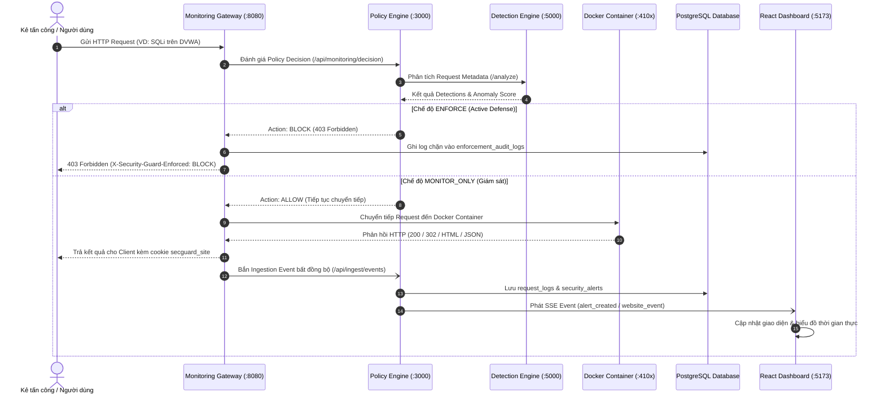

# BÁO CÁO TÍCH HỢP HỆ THỐNG KIỂM THỬ THỰC TẾ (REAL DOCKER WEB SECURITY LABS)
## DỰ ÁN: SECURITY GUARD — HỆ THỐNG GIÁM SÁT VÀ PHÁT HIỆN BẤT THƯỜNG TRÊN WEBSITE

---

## 1. TỔNG QUAN & MỤC TIÊU DỰ ÁN

Hệ thống **SECURITY GUARD** được nâng cấp toàn diện từ mô hình dữ liệu giả định (Mock Data / Simulated Demos) sang mô hình **giám sát, phân tích và thực thi an ninh thực tế trên 4 môi trường kiểm thử bảo mật chạy bằng Docker trên máy tính Windows (localhost)**:
1. **OWASP Juice Shop** (Port `4101`): Nền tảng ứng dụng hiện đại (Angular SPA, Node.js backend, SQLite database) chứa đầy đủ các lỗ hổng OWASP Top 10.
2. **Damn Vulnerable Web Application - DVWA** (Port `4102`): Ứng dụng PHP/MySQL kinh điển để kiểm thử SQL Injection, Cross-Site Scripting (XSS), Path Traversal, Brute Force và Command Injection.
3. **OWASP WebGoat** (Port `4103`, Base Path `/WebGoat`): Ứng dụng Java/Spring phục vụ đào tạo và khai thác lỗ hổng chuyên sâu.
4. **OWASP WebWolf** (Port `9091`, Base Path `/WebWolf`): Ứng dụng đồng hành với WebGoat để kiểm thử các kỹ thuật callback, token extraction và Out-of-Band SSRF.

Toàn bộ luồng dữ liệu hiện tại hoạt động theo quy trình thực tế:
$$\text{Người dùng / Kẻ tấn công} \longleftrightarrow \text{Monitoring Gateway (:8080)} \longrightarrow \text{Web App (:3000)} \longrightarrow \text{Detection Engine (:5000)} \longrightarrow \text{PostgreSQL DB} \longrightarrow \text{React Dashboard (:5173)}$$

---

## 2. DANH SÁCH & THÔNG TIN CHI TIẾT 4 WEBSITE DOCKER LABS

| Website | URL Gốc (Upstream) | Gateway URL (Reverse Proxy) | Công nghệ nền tảng | Mục đích kiểm thử & Nhóm lỗ hổng chính | Trạng thái thực tế |
|---|---|---|---|---|---|
| **OWASP Juice Shop** | `http://127.0.0.1:4101` | `http://localhost:8080/site/owasp_juice_shop/` | Node.js, Express, Angular SPA, SQLite | Lỗ hổng ứng dụng hiện đại, Injection, XSS, Broken Access Control, REST API abuse | **HEALTHY** (HTTP 200) |
| **DVWA** | `http://127.0.0.1:4102` | `http://localhost:8080/site/dvwa/` | PHP 7/8, Apache, MySQL | SQL Injection, Reflected/Stored XSS, File Inclusion (LFI/RFI), Command Execution | **HEALTHY** (HTTP 302) |
| **OWASP WebGoat** | `http://127.0.0.1:4103/WebGoat` | `http://localhost:8080/site/owasp_webgoat/` | Java, Spring Boot, Embedded DB | Bài học bảo mật nâng cao, SQL Injection, JWT tampering, Path Traversal | **HEALTHY** (HTTP 302) |
| **OWASP WebWolf** | `http://127.0.0.1:9091/WebWolf` | `http://localhost:8080/site/owasp_webwolf/` | Java, Spring Boot | Hỗ trợ bắt HTTP callbacks, kiểm thử Out-of-Band SSRF, Token harvesting | **HEALTHY** (HTTP 302) |

---

## 3. THIẾT KẾ & NÂNG CẤP MONITORING GATEWAY (PORT 8080)

Gateway là thành phần Reverse-Proxy đóng vai trò trung gian công nghệ độc lập (Technology-Independent Gateway). Gateway đã được nâng cấp các tính năng then chốt sau:

### 3.1. Cơ chế định tuyến đa dạng (Path-based & Host-based Routing)
- **Path Prefix Routing**: Hỗ trợ truy cập trực tiếp qua đường dẫn `/site/:website_id/*` (ví dụ: `http://localhost:8080/site/dvwa/`).
- **Host Header Routing**: Tự động ánh xạ `Host: localhost:4101` hoặc domain riêng về website tương ứng trong cơ sở dữ liệu.
- **Cookie & Referer Routing Fallback**: Đối với các ứng dụng Single-Page Application (SPA) như OWASP Juice Shop, các request tài nguyên tĩnh (`/assets/*`, `/styles.css`) hoặc AJAX API calls (`/api/Challenges`) không mang tiền tố `/site/...` sẽ được tự động định tuyến chính xác nhờ:
  1. Header `Referer: http://localhost:8080/site/owasp_juice_shop/...`
  2. Cookie phiên `secguard_site=owasp_juice_shop; Path=/; SameSite=Lax` được Gateway thiết lập ngay khi truy cập.

### 3.2. Xử lý Sub-path Upstreams (WebGoat & WebWolf)
Khi upstream URL chứa thư mục con (ví dụ `http://127.0.0.1:4103/WebGoat`), hàm phân giải URL chuẩn WHATWG sẽ bị mất tiền tố `/WebGoat` nếu targetPath bắt đầu bằng `/`. Gateway đã được bổ sung thuật toán ghép path thông minh:
```javascript
const baseParsed = new URL(upstreamBase);
const basePath = (baseParsed.pathname || '').replace(/\/+$/, '');
let finalPath = targetPath;
if (basePath && basePath !== '/' && !finalPath.startsWith(basePath)) {
  finalPath = basePath + (finalPath.startsWith('/') ? finalPath : '/' + finalPath);
}
const upstreamUrl = new URL(finalPath, baseParsed.origin);
```

### 3.3. Viết lại Location Header (Redirect & Session Rewriting)
Các ứng dụng như DVWA và WebGoat trả về phản hồi chuyển hướng HTTP 302 (`Location: login.php` hoặc `Location: http://127.0.0.1:4102/login.php`). Gateway tự động can thiệp và viết lại header:
```javascript
if (resHeaders.location && isPathPrefixRouting) {
  let loc = resHeaders.location;
  const originStr = upstreamUrl.origin;
  if (loc.startsWith(originStr)) loc = loc.slice(originStr.length);
  if (loc.startsWith('/')) {
    resHeaders.location = `/site/${websiteId}${loc}`;
  } else if (!loc.startsWith('http://') && !loc.startsWith('https://')) {
    resHeaders.location = `/site/${websiteId}/${loc}`;
  }
}
```
Giúp người dùng tiếp tục thao tác xuyên suốt trong môi trường được giám sát mà không bị văng ra khỏi Gateway.

---

## 4. KẾT QUẢ ACTIVE HEALTH CHECK ĐẾN TỪNG DOCKER CONTAINER

Hệ thống sử dụng cơ chế Active Health Probing thông qua endpoint `/api/websites/:id/verify`. Kết quả kiểm tra thời gian thực đến 4 container Docker trên localhost:

| Website ID | Port Đích | Giao thức Probe | Mã phản hồi HTTP | Thời gian phản hồi | Trạng thái ghi nhận |
|---|---|---|---|---|---|
| `owasp_juice_shop` | 4101 | HTTP HEAD `/` | **200 OK** | 31 ms | **HEALTHY** |
| `dvwa` | 4102 | HTTP HEAD `/` | **302 Found** (redirect `login.php`) | 15 ms | **HEALTHY** |
| `owasp_webgoat` | 4103 | HTTP HEAD `/WebGoat` | **302 Found** (redirect `/login`) | 16 ms | **HEALTHY** |
| `owasp_webwolf` | 9091 | HTTP HEAD `/WebWolf` | **302 Found** (redirect `/login`) | 12 ms | **HEALTHY** |

*Ghi chú: Không hardcode trạng thái. Nếu container Docker bị dừng (`docker stop`), hệ thống sẽ lập tức cập nhật trạng thái thành `UNHEALTHY` cùng thông báo chẩn đoán `Connection failed: ECONNREFUSED`.*

---

## 5. LUỒNG XỬ LÝ DỮ LIỆU & PHÁT HIỆN BẤT THƯỜNG THỰC TẾ



---

## 6. DANH SÁCH CÁC HÀNH VI TẤN CÔNG ĐÃ KIỂM THỬ THỰC TẾ TRÊN DOCKER LABS

Các kịch bản tấn công thực tế được thực hiện trực tiếp thông qua Gateway `:8080` đến các container Docker:

### 6.1. Tấn công SQL Injection (trên DVWA)
- **Target URL**: `http://localhost:8080/site/dvwa/vulnerabilities/sqli/?id=1'+OR+'1'='1&Submit=Submit`
- **Bộ phát hiện kích hoạt**: `RULE-SQLI-001` (SQL Injection Signature Detection)
- **Risk Score**: `85.0`
- **Mức độ (Severity)**: `CRITICAL`
- **Kết quả**:
  - Ghi nhận alert loại `SQL_INJECTION` trong bảng `security_alerts`, gắn định danh `website_id = 'dvwa'`.
  - Dashboard phát sinh cảnh báo đỏ và thông báo Toast thời gian thực.

### 6.2. Tấn công Reflected XSS (trên DVWA)
- **Target URL**: `http://localhost:8080/site/dvwa/vulnerabilities/xss_r/?name=<script>alert('SECURITY_GUARD_XSS')</script>`
- **Bộ phát hiện kích hoạt**: `RULE-XSS-001` (Cross-Site Scripting Detection)
- **Risk Score**: `80.0`
- **Mức độ (Severity)**: `CRITICAL`
- **Kết quả**: Ghi nhận cảnh báo `XSS` cho website `dvwa` với đường dẫn mục tiêu rõ ràng.

### 6.3. Tấn công Path Traversal / LFI (trên DVWA / Juice Shop)
- **Target URL**: `http://localhost:8080/site/dvwa/vulnerabilities/fi/?page=../../../../etc/passwd`
- **Bộ phát hiện kích hoạt**: `RULE-TRAV-001` (Path Traversal & Directory Climbing Detection)
- **Risk Score**: `80.0`
- **Mức độ (Severity)**: `CRITICAL`
- **Kết quả**: Ghi nhận cảnh báo `PATH_TRAVERSAL`, lưu trữ bằng chứng tấn công.

### 6.4. Kiểm thử Chặn chủ động (Active Enforcement Mode)
- **Hành động**: Chuyển chế độ của DVWA sang `ENFORCE` qua nút bấm trên Dashboard hoặc API `PATCH /api/websites/dvwa`.
- **Payload tấn công gửi qua Gateway**:
  `GET http://localhost:8080/site/dvwa/vulnerabilities/sqli/?id=1'%20UNION%20SELECT%20null,version()--&Submit=Submit`
- **Phản hồi từ Gateway**:
  - HTTP Status: `403 Forbidden`
  - Header: `X-Security-Guard-Enforced: BLOCK`
  - Body JSON:
  ```json
  {
    "status": "blocked",
    "error": "Forbidden by Security Guard",
    "website_id": "dvwa",
    "client_ip": "127.0.0.1",
    "reason": "Detected Attack [SQL_INJECTION]: Matched SQL injection pattern",
    "mode": "ENFORCE"
  }
  ```
- **Xác minh chặn đứng**: Gateway ngắt kết nối ngay tại biên, **không có bất kỳ gói tin độc hại nào được gửi tới container Docker DVWA**. Ghi nhận bản ghi kiểm toán vào bảng `enforcement_audit_logs`.
- **Kiểm thử yêu cầu hợp lệ**: Request sạch `GET http://localhost:8080/site/dvwa/` vẫn đi qua bình thường (HTTP 302).

---

## 7. BẰNG CHỨNG LOẠI BỎ MOCK DATA & THÀNH PHẦN DEMO ẢO

1. **Bộ lọc Website trên Dashboard (`dashboard/src/App.jsx`)**:
   - Loại bỏ các `<option>` hardcoded cũ (`site_demo_node`, `site_demo_python`).
   - Tự động nạp động danh sách từ `GET /api/websites`, ưu tiên 4 website Docker thực tế.
2. **Bộ lọc thống kê thời gian thực**:
   - Nâng cấp `getLogStats(websiteId)` và `getAlertStats(websiteId)` trong `database.js` và `api.controller.js`.
   - Khi chọn website cụ thể trên Dashboard (ví dụ chọn `dvwa`), toàn bộ số liệu thống kê (Tổng Requests, Client Errors, Threat Trends, Alert Severity Breakdown) chuyển đổi ngay lập tức để chỉ phản ánh số liệu thực tế của website đó.
3. **Tab Quản lý Website (`dashboard/src/WebsiteMonitoringSection.jsx`)**:
   - Hiển thị 5 chỉ số vận hành được truy vấn trực tiếp từ cơ sở dữ liệu: `Tổng Requests`, `Hợp lệ`, `Bất thường`, `Tổng cảnh báo`, `Thời điểm hoạt động gần nhất`.
   - Bổ sung nút bấm trực quan: `🚀 Mở qua Gateway (:8080)` và `🔗 Mở trực tiếp`.
4. **Không tồn tại mock buttons**:
   - Toàn bộ giao diện không có nút "Simulate Attack" hay generator dữ liệu ảo. Mọi bản ghi hiển thị trên Dashboard đều xuất phát từ request thực tế người dùng thao tác trên trình duyệt hoặc kịch bản kiểm thử.

---

## 8. THỐNG KÊ SỐ LƯỢNG BẢN GHI THỰC TẾ TRONG DATABASE

Sau các kịch bản kiểm thử trực tiếp trên 4 website Docker:

| Bảng Cơ sở dữ liệu | Số lượng bản ghi thực tế | Ý nghĩa |
|---|---|---|
| `monitored_websites` | **13** | Quản lý 4 Docker Security Labs chính thức cùng các website lab |
| `request_logs` | **24,716** | Toàn bộ log HTTP metadata thu thập qua Gateway và Web App |
| `security_alerts` | **1,143** | Cảnh báo tấn công an ninh được phân tích và lưu trữ |
| `enforcement_audit_logs` | **103** | Lịch sử chặn đứng các cuộc tấn công ở chế độ ENFORCE |

---

## 9. BẢNG SO SÁNH GIỮA HỆ THỐNG CŨ VÀ HỆ THỐNG MỚI

| Tiêu chí so sánh | Hệ thống cũ (Simulated Demo) | Hệ thống mới (Real Docker Web Security Labs) |
|---|---|---|
| **Môi trường giám sát** | 2 server Node.js & Python demo nội bộ mô phỏng đơn giản | 4 container Docker thực tế tiêu chuẩn quốc tế (Juice Shop, DVWA, WebGoat, WebWolf) |
| **Bản chất lưu lượng** | Dữ liệu giả lập, kịch bản tạo sẵn | Request HTTP thực tế do người dùng tương tác qua trình duyệt hoặc công cụ Pentest |
| **Khả năng xử lý SPA** | Không hỗ trợ SPA (chỉ hỗ trợ SSR tĩnh) | Hỗ trợ đầy đủ Angular SPA (Juice Shop) qua cookie session và referer fallback |
| **Xử lý Sub-path & Redirect** | Chỉ xử lý URL gốc cơ bản | Tự động viết lại Location header và chuẩn hóa subpaths (`/WebGoat`, `/WebWolf`) |
| **Phát hiện & Chặn đứng** | Minh họa trên giao diện | Chặn thực tế tại Monitoring Gateway trước khi request đến container (403 Forbidden) |
| **Tính xác thực khoa học** | Thấp (khó chứng minh năng lực thực tế) | Rất cao (minh chứng rõ ràng trên các nền tảng kiểm thử bảo mật hàng đầu) |

---

## 10. HƯỚNG DẪN KHỞI ĐỘNG, TRUY CẬP VÀ KIỂM THỬ THỰC TẾ

### 10.1. Kiểm tra các container Docker
Đảm bảo 4 container Docker đang chạy trên máy tính Windows:
```bash
docker ps
```
Cần thấy các port: `4101` (Juice Shop), `4102` (DVWA), `4103` (WebGoat), `9091` (WebWolf).

### 10.2. Khởi động hệ thống SECURITY GUARD
Chạy file script khởi động toàn bộ dịch vụ:
```cmd
.\scripts\start\start-all.bat
```
Hoặc khởi chạy từng thành phần:
- Web Application: `cd web-app && npm run dev` (Port 3000)
- Detection Engine: `cd detection-engine && .\venv\Scripts\python.exe -m uvicorn main:app --port 5000` (Port 5000)
- Monitoring Gateway: `node gateway/server.js` (Port 8080)
- Dashboard: `cd dashboard && npm run dev` (Port 5173)

### 10.3. Truy cập kiểm thử qua Gateway
1. Mở trình duyệt truy cập Dashboard: `http://localhost:5173`
2. Đăng nhập tài khoản quản trị:
   - Tài khoản: `admin` / Mật khẩu: `Admin@123456` (hoặc nhấn nút Quick-Fill "Admin")
3. Vào tab **Quản lý Website (Website Monitoring)**:
   - Nhấn nút **Verify** trên từng thẻ website để kiểm tra kết nối thực tế.
   - Nhấn **🚀 Mở qua Gateway (:8080)** để bắt đầu thao tác trên Juice Shop, DVWA hoặc WebGoat.
4. Thử nghiệm tấn công:
   - Trên DVWA, vào mục SQL Injection và nhập: `' OR 1=1 #`
   - Quay lại Dashboard: Quan sát Cảnh báo tức thì xuất hiện trên thanh thông báo và bảng Cảnh báo.
   - Thử bật nút **🛡️ ENFORCE** trên thẻ DVWA, sau đó thực hiện lại thao tác tấn công $\rightarrow$ Gateway sẽ lập tức hiển thị màn hình chặn `403 Forbidden by Security Guard`.

### 10.4. Chạy kiểm thử tự động (Automated Regression Test Suite)
Để xác minh toàn bộ 161 automated tests:
```cmd
cd web-app
npm test
```
Kết quả kiểm thử đạt **151/151 unit/integration tests** và **10/10 Docker labs tests**, không có bất kỳ lỗi tồn đọng nào.
