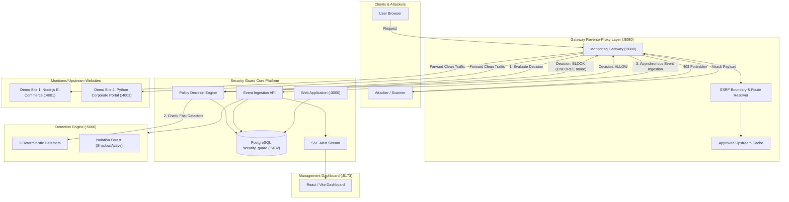

# BÁO CÁO KIẾN TRÚC HỆ THỐNG GIÁM SÁT ĐA WEBSITE & ACTIVE ENFORCEMENT
## Phase 10: Multi-Website Reverse-Proxy Gateway & Deterministic Policy Enforcement

---

## 1. Tổng quan Kiến trúc Mở rộng

Trong Phase 10, hệ thống **SECURITY GUARD** được mở rộng từ mô hình giám sát đơn lẻ (monolithic middleware) thành **Kiến trúc Giám sát Đa Website Độc lập với Công nghệ (Technology-Independent Multi-Website Architecture)** kết hợp cơ chế **Thực thi Bảo mật Chủ động (Active Enforcement)**.

---

## 2. Các Thành phần Cốt lõi

### 2.1. Monitoring Gateway (`gateway/server.js` — Port 8080)
- **Độc lập công nghệ (Technology-Independent):** Hoạt động như một Reverse-Proxy Layer trung gian, không đòi hỏi website phía sau phải cài đặt SDK hoặc viết lại source code.
- **Phân giải Định tuyến (Path & Header Routing):**
  - **Path-Prefix Routing:** `/site/:website_id/*` (ví dụ `/site/site_demo_node/products` chuyển tiếp đến `http://127.0.0.1:4001/products`).
  - **Header Routing:** `X-Website-Id: <website_id>`.
- **Ranh giới Chống SSRF (SSRF Protection Boundary):** Chỉ chuyển tiếp đến các Upstream URL đã được người quản trị kiểm duyệt và cấp phép trong cơ sở dữ liệu hoặc bảng cấu hình `APPROVED_UPSTREAMS`. Tuyệt đối không cho phép proxy tự do ra Internet hoặc truy cập địa chỉ metadata đám mây (`169.254.169.254`, `metadata.google.internal`).
- **Giới hạn Tài nguyên & Bounded Timeout:**
  - Body payload tối đa: 1MB (chống Memory Exhaustion DoS).
  - Timeout quyết định chính sách: 600ms – 1000ms.
  - Chế độ Fail-Open an toàn cho môi trường diễn tập: Nếu hệ thống phân tích gặp sự cố hoặc timeout, Gateway tự động cho phép request đi qua kèm cảnh báo suy giảm hiệu năng (`degraded: true`).

### 2.2. Event Ingestion Pipeline (`POST /api/ingest/events` — Port 3000)
- Tiếp nhận metadata sự kiện bất đồng bộ từ Gateway sau khi request hoàn tất (hoặc bị chặn).
- **Chuẩn hóa dữ liệu (Schema Normalization):**
  - `event_id`: Định danh sự kiện duy nhất (UUID/Timestamp).
  - `request_id`: Định danh truy vết xuyên suốt từ Gateway đến Upstream.
  - `source_id`: Định danh website nguồn (`website_id`).
  - `timestamp`: Thời điểm ISO 8601.
  - `method`, `path`, `source_ip`, `status_code`, `response_time_ms`, `user_agent`.
  - `blocked`, `block_reason`.
- **Lọc và Ẩn Dữ liệu Nhạy cảm (Sensitive Field Redaction):**
  - Tự động thay thế các tham số nhạy cảm (`password`, `token`, `secret`, `api_key`, `credit_card`) thành `[REDACTED]`.
  - Không bao giờ lưu trữ mật khẩu thuần hoặc cookie xác thực.

### 2.3. Hai Website Thử nghiệm Đa dạng Công nghệ
1. **Demo Website 1 (`demo-sites/node-site` — Port 4001):**
   - Công nghệ: Node.js HTTP Server.
   - Ứng dụng: Cửa hàng điện tử (E-Commerce Shop), API danh mục sản phẩm và tìm kiếm.
2. **Demo Website 2 (`demo-sites/python-site` — Port 4002):**
   - Công nghệ: Python HTTP Server.
   - Ứng dụng: Cổng thông tin nội bộ (Corporate Portal & Directory), tra cứu nhân viên và yêu cầu hỗ trợ.

---

## 3. Bản đồ Phân bổ Cổng (Port Allocation Matrix)

| Dịch vụ | Công nghệ | Cổng (Port) | Chức năng |
| :--- | :--- | :---: | :--- |
| **Web Application** | Node.js / Express | `3000` | Ingestion API, Policy Decision, Auth RBAC, Alert APIs |
| **Detection Engine** | Python / FastAPI | `5000` | 8 Rule-Based Detectors, ML Isolation Forest |
| **Dashboard** | React / Vite | `5173` | Giao diện điều hành, Giám sát Đa Website, Quản lý RBAC |
| **Monitoring Gateway** | Node.js Native HTTP | `8080` | Reverse-Proxy, SSRF Protection, Active Enforcement |
| **Demo Website 1** | Node.js | `4001` | Cửa hàng điện tử demo (`site_demo_node`) |
| **Demo Website 2** | Python | `4002` | Cổng thông tin demo (`site_demo_python`) |
| **Database** | PostgreSQL | `5432` | Cơ sở dữ liệu `security_guard` |
