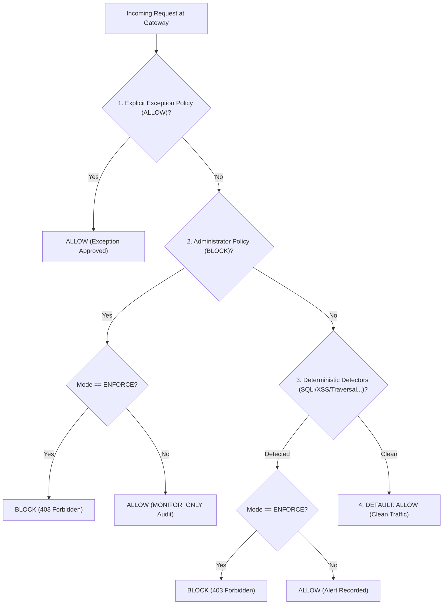

# CHÍNH SÁCH THỰC THI BẢO MẬT & QUY TRÌNH RA QUYẾT ĐỊNH
## Phase 10: Security Enforcement Policies & Decision Lifecycle

---

## 1. Hai Chế độ Vận hành Cốt lõi (Operating Modes)

Mỗi website được đăng ký trong hệ thống sở hữu thuộc tính `monitoring_mode` độc lập:

### 1.1. Chế độ `MONITOR_ONLY` (Chỉ Giám sát & Cảnh báo)
- **Mục đích:** Giai đoạn quan sát lưu lượng, thu thập dữ liệu huấn luyện ML, đánh giá tỷ lệ dương tính giả (False Positive) trước khi áp dụng luật chặn.
- **Hành vi:**
  - Mọi request (kể cả request chứa payload tấn công hoặc vi phạm chính sách) **đều được cho phép đi qua Upstream** (`action: 'ALLOW'`).
  - Hệ thống ghi nhận cảnh báo an ninh vào cơ sở dữ liệu `security_alerts`, phát sinh sự kiện SSE thời gian thực và ghi vào `enforcement_audit_logs` với trạng thái `ALLOWED_MONITOR`.
  - Không bao giờ làm gián đoạn trải nghiệm người dùng hoặc dịch vụ website.

### 1.2. Chế độ `ENFORCE` (Thực thi Chặn Chủ động)
- **Mục đích:** Bảo vệ chủ động khi website chịu các đợt quét lỗ hổng hoặc tấn công khai thác rõ ràng.
- **Hành vi:**
  - Gateway gửi metadata đến `POST /api/monitoring/decision` trước khi chuyển tiếp.
  - Nếu request vi phạm chính sách do quản trị viên đặt hoặc khớp các detector tấn công nguy hiểm, Gateway lập tức phản hồi **HTTP 403 Forbidden** và ngắt kết nối, không cho payload độc hại chạm đến Upstream.
  - Ghi nhận đầy đủ nhật ký kiểm toán `enforcement_audit_logs` với trạng thái `BLOCKED` kèm lý do cụ thể.

---

## 2. Thứ tự Ưu tiên Ra Quyết định (Decision Priority Hierarchy)

1. **Ưu tiên 1 (Cao nhất): Ngoại lệ Cho phép Chủ động (`ALLOW` Policy):**
   - Áp dụng khi quản trị viên whitelist IP nội bộ, máy chủ quét lỗ hổng bảo mật được ủy quyền hoặc công cụ kiểm thử tự động.
   - Khi khớp, request được cho phép qua ngay lập tức, bỏ qua các bộ chặn phía sau.
2. **Ưu tiên 2: Chính sách Quản trị Chặn Tùy chỉnh (`BLOCK` Policy):**
   - `IP_BLOCK`: Chặn địa chỉ IP độc hại, Botnet hoặc dải mạng nghi vấn.
   - `PATH_RESTRICT`: Chặn truy cập vào đường dẫn nhạy cảm (ví dụ `/admin`, `/.git`, `/config`).
3. **Ưu tiên 3: Các Luật Phát hiện Xác định (8 Deterministic Detectors):**
   - `SQL_INJECTION`: Phát hiện payload tiêm mã SQL (`' OR 1=1--`, `UNION SELECT`).
   - `XSS`: Phát hiện tiêm mã kịch bản chéo (`<script>`, `javascript:`).
   - `COMMAND_INJECTION`: Phát hiện lệnh hệ điều hành (`; cat /etc/passwd`, `| dir`).
   - `PATH_TRAVERSAL`: Phát hiện duyệt thư mục (`../`, `..\win.ini`).
   - `SCANNER`: Nhận diện công cụ quét (Nikto, SQLMap, Nmap, DirBuster).
   - `SUSPICIOUS_URL`: Phát hiện dò quét đường dẫn nhạy cảm (`/wp-login.php`, `/.env`).
   - `BRUTE_FORCE` & `ABNORMAL_TRAFFIC`: Tần suất truy cập bất thường.
4. **Ưu tiên 4: Cho phép Mặc định (Default Allow):**
   - Khi request không vi phạm bất kỳ chính sách nào, hệ thống mặc định cho phép truy cập.

---

## 3. Chính sách Cách ly Máy học (ML Isolation Forest Demarcation)

- Mô hình **Isolation Forest** được thiết kế để phân tích độ bất thường tổng thể của luồng traffic dựa trên 11 đặc trưng số học.
- **Nguyên tắc an toàn:** Không tự động chặn lưu lượng chỉ dựa trên điểm bất thường ML nhằm tránh rủi ro dương tính giả (False Positives) ảnh hưởng đến người dùng thực.
- Điểm dị biệt ML được sử dụng để:
  - Làm giàu thông tin phân tích (Enrichment Telemetry).
  - Gợi ý cho chuyên viên an ninh (Security Analyst) kiểm tra nguồn IP.
  - Phục vụ cơ chế tự động đề xuất chính sách chặn tạm thời khi có xác nhận của quản trị viên.
