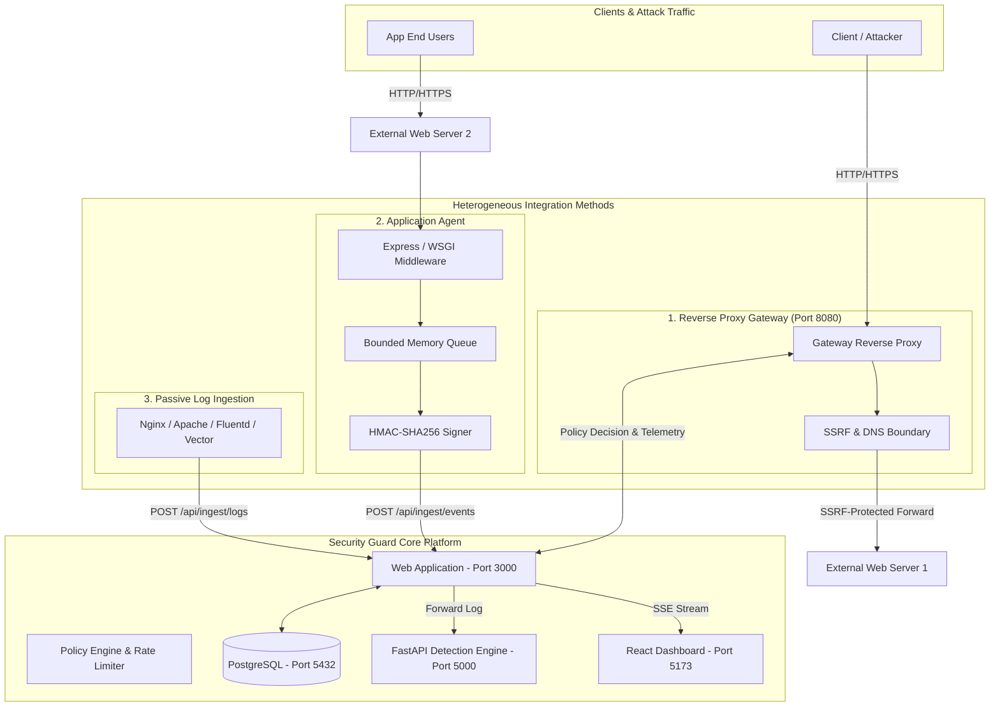

# Phase 11 — External Website Integration Architecture

## 1. System Overview

Security Guard Phase 11 expands the monitoring and active enforcement perimeter from built-in demo targets to arbitrary external websites across heterogeneous environments.

---

## 2. Integration Archetypes

| Method | Traffic Flow | Active Enforcement Support | Invasiveness | Best Suited For |
| :--- | :--- | :--- | :--- | :--- |
| **REVERSE_PROXY** | In-line via Gateway (8080) | **Yes** (Instant 403 Forbidden drop) | Non-invasive (DNS routing only) | Legacy systems, unmodifiable apps, APIs |
| **APPLICATION_AGENT** | Out-of-band asynchronous | Observability & Policy alerting | Low (single middleware line) | Modern Express/Flask/Django services |
| **LOG_INGESTION** | Passive batch ingestion | Passive detection only | Zero (log shipper daemon) | Nginx/Apache clusters, cloud log streams |

---

## 3. Data Protection & Sensitive Field Redaction

All data entering the telemetry ingestion pipeline undergoes automatic sanitization before persistence and forward propagation:
1. **Query Parameters**: Parameters matching `password`, `token`, `secret`, `api_key`, `auth`, `cookie`, `credit_card` are scrubbed and replaced with `[REDACTED]`.
2. **Payload Bodies**: JSON payloads are recursively traversed, replacing sensitive keys while preserving structure and length metrics for ML feature extraction.
3. **URL Normalization**: URLs are decoded, normalized, and trimmed of trailing delimiters to prevent pattern evasion.

---

## 4. SSRF & DNS Rebinding Hardening

External website proxying is guarded by `ssrfValidator.js`:
- Prohibits non-routable, link-local, loopback, and private IPv4 ranges: `0.0.0.0/8`, `10.0.0.0/8`, `127.0.0.0/8`, `169.254.0.0/16`, `172.16.0.0/12`, `192.168.0.0/16`, `100.64.0.0/10`.
- Prohibits cloud metadata endpoints: `169.254.169.254` (AWS, GCP, Azure, OpenStack).
- Prohibits IPv6 private / link-local: `::1`, `fc00::/7`, `fe80::/10`.
- Inspects all resolved IP addresses returned by DNS queries before issuing upstream sockets.
