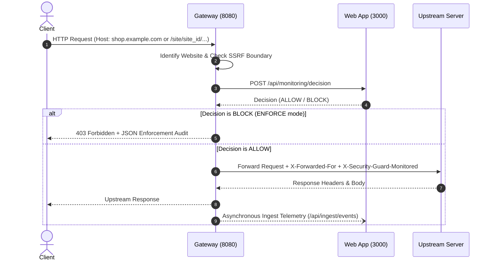

# Reverse Proxy Integration & SSRF Hardening Guide

## 1. Overview
The Reverse Proxy integration routes all user traffic through the **Security Guard Monitoring Gateway (Port 8080)** before forwarding requests to the target application.

## 2. Gateway Architecture & Request Flow



## 3. Configuration & Routing

The Gateway supports three routing mechanisms:

### Method A: Path-Based Prefix Routing
All requests with path `/site/:website_id/*` are automatically stripped of the prefix and proxied to the corresponding upstream server:
```bash
curl -i http://localhost:8080/site/site_demo_node/products
```

### Method B: Header-Based Website Identifier
Specify the explicit `X-Website-Id` header:
```bash
curl -i -H "X-Website-Id: site_demo_python" http://localhost:8080/portal
```

### Method C: Host Header Domain Routing
Point your DNS CNAME / A record for `shop.example.com` to the Gateway IP. The Gateway automatically resolves the domain against the website registry:
```bash
curl -i -H "Host: shop.example.com" http://localhost:8080/
```

---

## 4. SSRF Defense & Security Constraints

To prevent Server-Side Request Forgery (SSRF) and DNS Rebinding:
1. **Forbidden Ranges**: Destination hostnames cannot resolve to loopback (`127.0.0.0/8`, `::1`), link-local (`169.254.0.0/16`), RFC1918 private subnets (`10.0.0.0/8`, `172.16.0.0/12`, `192.168.0.0/16`), or Carrier-Grade NAT (`100.64.0.0/10`).
2. **Cloud Metadata Ban**: Requests to `169.254.169.254` or `metadata.google.internal` are strictly dropped with HTTP 502 SSRF Violation.
3. **Multi-IP Resolution**: If a hostname resolves to multiple IP addresses, every resolved IP is validated; if any address violates boundary rules, the connection is rejected.
4. **Timeouts**: Gateway upstream connections enforce a strict 5000ms socket timeout and 1MB maximum buffered payload.
